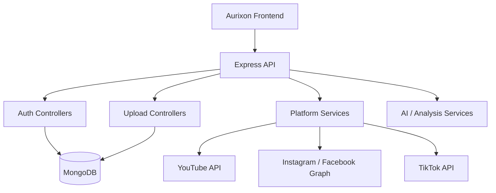

# Aurixon Backend

Multi-platform content publishing API for creators.  
Supports **YouTube**, **Instagram**, **Facebook**, and **TikTok** with OAuth, scheduling, media upload orchestration, and content analysis services.

> Production-oriented Node.js / Express backend. Designed to work with the [Aurixon Frontend](https://github.com/zafaraieng/AurixonAIFrontend).

---

## Problem Being Solved

Creators often need to publish the same media to multiple platforms with consistent metadata, scheduling, and compliance checks. Manual uploads are time-consuming and error-prone. Aurixon provides a unified backend that:

- Authenticates users via platform OAuth flows
- Accepts media and metadata once
- Orchestrates uploads / publishes to selected platforms
- Tracks per-platform status
- Runs optional content validation and analysis

## Features (implemented)

- Google / YouTube OAuth and video upload flow
- Facebook / Instagram OAuth and media publishing
- TikTok OAuth and upload flow
- Scheduled publishing with status tracking
- Media upload handling (including Vercel-friendly strategies)
- Content analysis and validation services
- Session-based authentication with secure cookies
- Health endpoint and basic logging

## Architecture Overview



### Request Lifecycle (high level)

1. User authenticates via platform OAuth → tokens stored against User document.
2. Frontend submits media + metadata + target platforms + schedule.
3. Backend validates input, stores a `VideoSchedule` record, and orchestrates platform-specific upload logic.
4. Status is updated per platform; optional poller can refresh YouTube processing state.

## Tech Stack

- Node.js 22 · Express · Mongoose
- OAuth integrations (Google, Facebook, TikTok)
- Session cookies (`express-session` / custom middleware)
- Optional AI analysis (Hugging Face, Google Generative AI, etc.)
- Deployed on Vercel (serverless constraints considered in upload paths)

## Project Structure

```
├── app.js                 # Express application
├── server.js              # Entry point (MongoDB + scheduler)
├── config/                # Keys & auth configuration (env-driven)
├── controllers/           # Route handlers
├── middleware/            # Session, Instagram auth helpers
├── models/                # User, VideoSchedule, ContentFingerprint
├── routes/                # Route definitions
├── services/              # Platform & analysis services
├── utils/                 # Helpers
├── .env.example           # Sanitized environment template
└── package.json
```

## Environment Configuration

Copy `.env.example` to `.env` and fill in real values. **Never commit `.env`.**

| Variable | Description | Required |
|----------|-------------|----------|
| `MONGODB_URI` | MongoDB connection string | Yes |
| `SESSION_SECRET` | Long random string for cookie signing | Yes |
| `CLIENT_URL` | Frontend origin (CORS + redirects) | Yes |
| `PUBLIC_VIDEO_URL` | Public base URL for media | Production |
| `GOOGLE_CLIENT_ID` / `GOOGLE_CLIENT_SECRET` | Google OAuth | For YouTube |
| `FACEBOOK_APP_ID` / `FACEBOOK_APP_SECRET` | Facebook / Instagram | For IG/FB |
| `TIKTOK_CLIENT_KEY` / `TIKTOK_CLIENT_SECRET` | TikTok OAuth | For TikTok |
| `YOUTUBE_API_KEY` | YouTube Data API | Optional |
| `ENABLE_STATUS_POLLER` | `true` to enable YouTube status polling | No |

See `.env.example` for the full list.

## Local Setup

```bash
git clone https://github.com/zafaraieng/AurixonAIBackend.git
cd AurixonAIBackend
cp .env.example .env
# Edit .env with your values
npm install
npm run dev          # nodemon
# or
npm start            # production-style
```

Default port: `4000` (override with `PORT`).

## API Surface (selected)

- `GET /health` — liveness
- `/auth/*` — Google OAuth
- `/instagram/*` — Facebook / Instagram OAuth & actions
- `/tiktok/*` and `/callback/tiktok` — TikTok OAuth
- `/api/*` — upload, scheduling, status endpoints
- `/api/ai/*` — analysis helpers
- `/api/optimize/*` — title / content optimization helpers

Detailed OpenAPI-style documentation is planned.

## Security Notes

- `SESSION_SECRET` is **required**; the server refuses to start without it.
- OAuth client secrets and API keys must live only in environment variables.
- `.gitignore` blocks `.env`, keys, and credential files.
- A previous `.env` commit has been removed from the working tree; history cleanup (force-push after `git filter-repo`) should still be performed by the repository owner.

## Testing

Unit and integration tests with mocked platform responses are planned.  
Do not run tests against live platform credentials in CI.

## Deployment

Designed for Vercel. Set all required environment variables in the Vercel project settings.  
Be aware of serverless execution time and filesystem constraints when handling large media.

## Related Repository

Frontend: [zafaraieng/AurixonAIFrontend](https://github.com/zafaraieng/AurixonAIFrontend)

---

*Built as a practical full-stack AI/engineering project. Contributions and feedback welcome after the initial documentation and test coverage pass.*
